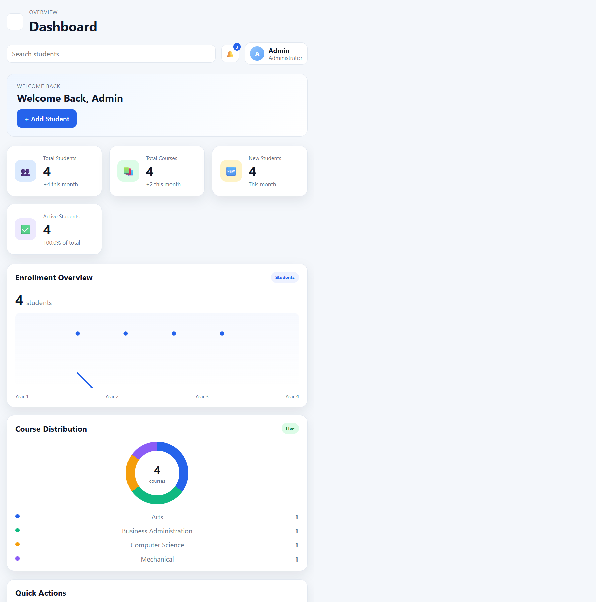

# Student Management System

A beginner-friendly student record management application built with Python, Flask, SQLite, and HTML/CSS. It includes a web-based admin dashboard and a layered backend structure that separates routes, business rules, database access, and validation.

## Dashboard screenshot

The screenshot below shows the running dashboard with database-backed student and course information.



## Features

- Dashboard summary of student and course totals.
- Recent student table with actions to view, edit, and delete records.
- Add, list, search, view, edit, and delete student records.
- Search by student ID, name, email, or course.
- Course and student-year distribution summaries based on saved records.
- SQLite database initialization from the checked-in SQL schema.
- Input validation for required fields, student ID, email, phone number, and year.
- Responsive dashboard and student pages with mobile navigation.
- Automated tests for repository and service behavior.

> Note: This is a learning project, not a production-ready system. It does not include authentication or user roles. Back up the SQLite database before making manual changes.

## Technology

- Python 3.10 or newer
- Flask
- SQLite (included with Python)
- HTML, CSS, and Jinja templates
- Pytest

## Project structure

```text
Student Management System/
├── backend/
│   └── app.py                  # Flask app and web routes
├── database/
│   ├── schema.sql              # Database table definitions
│   └── sample_data.sql         # Example SQL records
├── docs/
│   ├── dashboard-screenshot.png
│   └── project_overview.md
├── frontend/
│   ├── static/css/style.css    # Shared styles and responsive layout
│   └── templates/              # Jinja pages
├── src/
│   ├── controllers/            # Console interface
│   ├── models/                 # Student model
│   ├── repositories/           # SQLite queries
│   ├── services/               # Business rules and validation flow
│   └── utils/                  # Database setup and validation helpers
├── tests/                      # Pytest tests
├── FLOW.md
├── README.md
└── requirements.txt
```

SQLite creates its database file under the `database/` directory when the application starts. The `.venv/` virtual environment and generated database file are local runtime artifacts and are not required in the source tree.

## Installation

Open PowerShell or a terminal in the project directory, then create and activate a virtual environment.

### Windows PowerShell

```powershell
py -m venv .venv
.\.venv\Scripts\Activate.ps1
python -m pip install -r requirements.txt
```

If PowerShell blocks virtual-environment activation, use the environment's Python executable directly:

```powershell
.\.venv\Scripts\python.exe -m pip install -r requirements.txt
```

### macOS / Linux

```bash
python3 -m venv .venv
source .venv/bin/activate
python -m pip install -r requirements.txt
```

## Run the web application

From the project root, run:

```bash
python backend/app.py
```

Then open <http://127.0.0.1:5000/> in a browser. The root URL redirects to the dashboard. Stop the local development server with `Ctrl+C` in the terminal.

To use the project's existing virtual environment on Windows without activating it:

```powershell
.\.venv\Scripts\python.exe backend/app.py
```

Flask's built-in server is intended for local development only. Do not expose it as a production server.

## Web pages and routes

| Route | Purpose |
| --- | --- |
| `/` | Redirects to the dashboard |
| `/dashboard` | Shows student totals, course/year summaries, notifications, and recent students |
| `/students` | Adds students and lists saved records |
| `/students/search?q=keyword` | Searches by student ID, name, email, or course |
| `/students/<student_id>` | Displays an individual student's details |
| `/students/<student_id>/edit` | Edits a student record |
| `/students/<student_id>/delete` | Deletes a student record (POST) |
| `/courses` | Shows the course distribution summary |
| `/reports` | Shows student and year summary information |
| `/settings` | Shows basic application and database information |

## Database

The app initializes its SQLite database using `database/schema.sql` when the repository opens a database connection. To initialize the default database manually from the project root:

```bash
python -c "from src.utils.database import initialize_database; initialize_database()"
```

`database/sample_data.sql` contains example SQL inserts. The web app does not automatically load this sample file; add records through the Students page or execute the SQL against the database when sample records are needed.

## Run the tests

Install the project requirements, then run from the project root:

```bash
python -m pytest -q
```

The repository and service tests use isolated in-memory SQLite databases so they do not alter the local application's student records.

## Code overview

- `backend/app.py` defines Flask routes and connects page requests to the service layer.
- `src/services/student_service.py` validates student data and prepares dashboard summaries.
- `src/repositories/student_repository.py` contains SQLite operations.
- `src/utils/database.py` initializes the database and applies the schema.
- `src/utils/validators.py` contains reusable input checks.
- `src/models/student.py` describes the student data model.
- `frontend/templates/` contains the web pages; `frontend/static/css/style.css` contains shared styling.

## Known limitations and possible next steps

- No login, authentication, or role-based access control.
- No pagination or downloadable CSV/Excel reports.
- Course records are summarized from the course values on student records; courses are not maintained as a separate editable entity.
- The console entry point is retained for learning, while the Flask web dashboard is the primary application interface.

## License

No license has been specified for this project yet.
